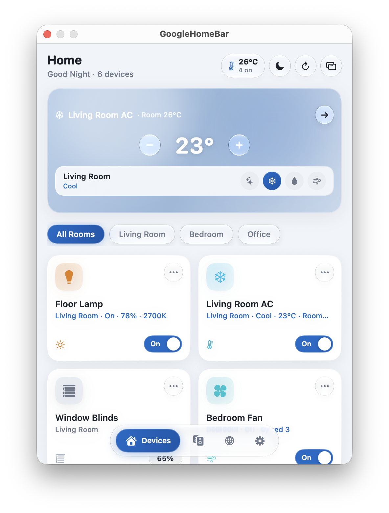
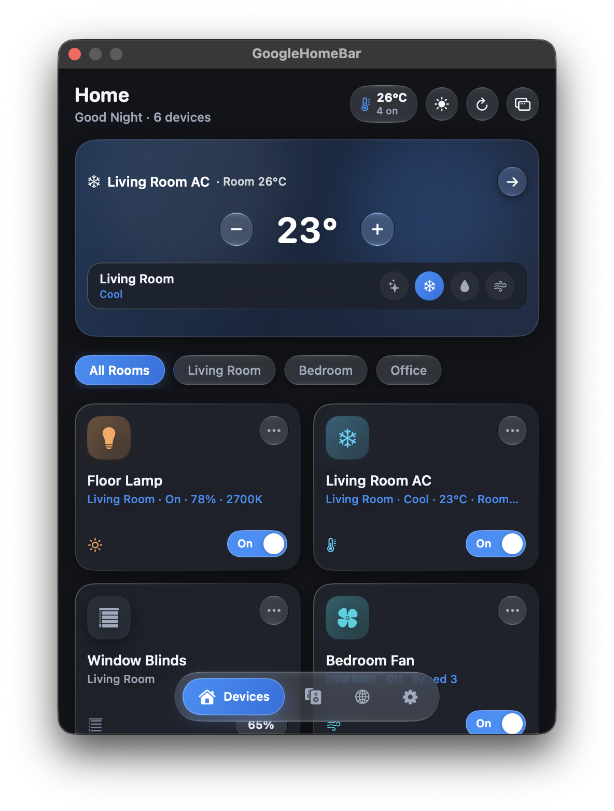
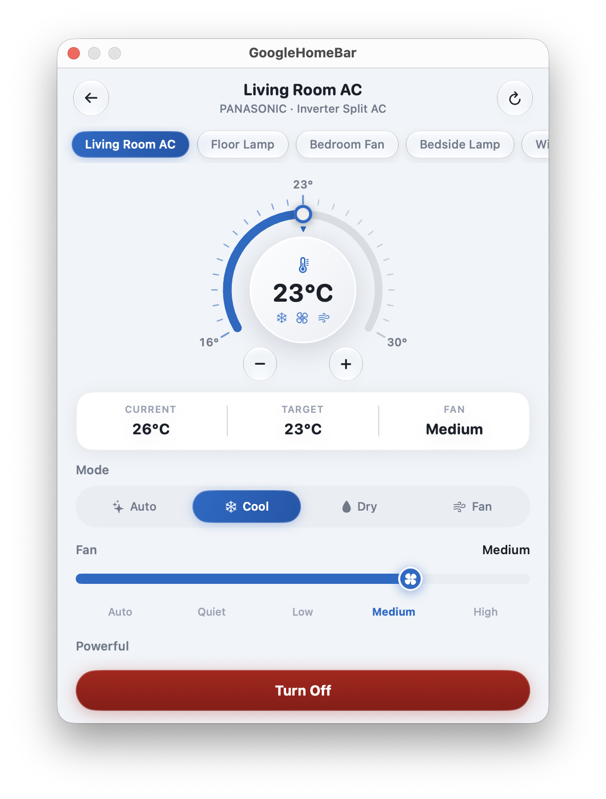
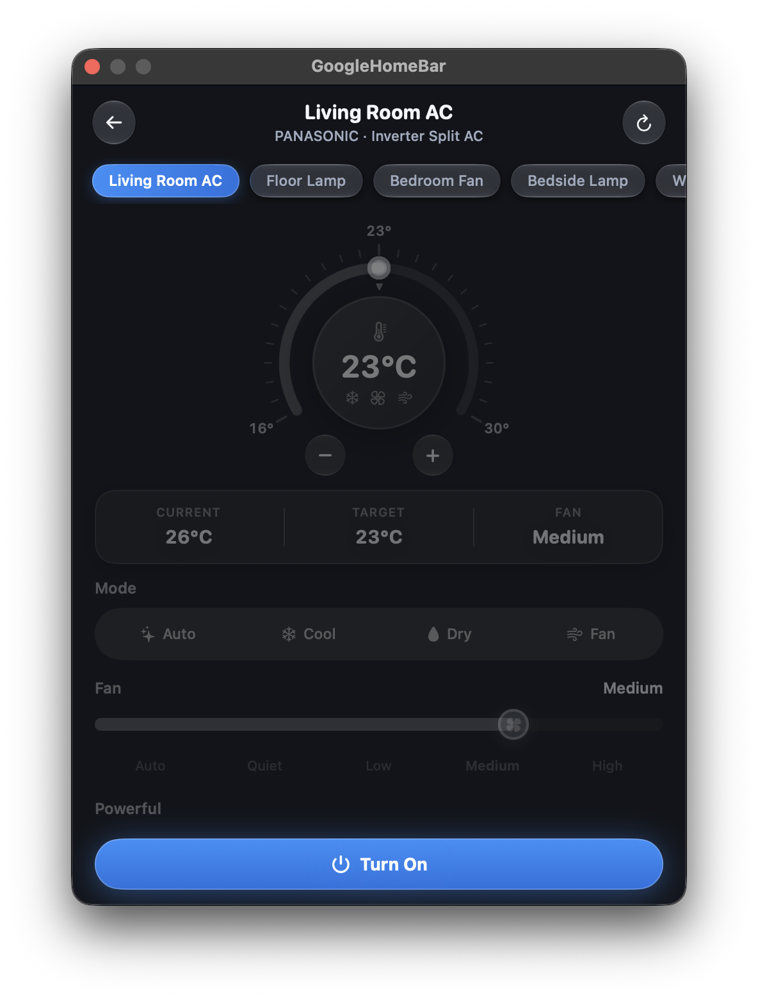
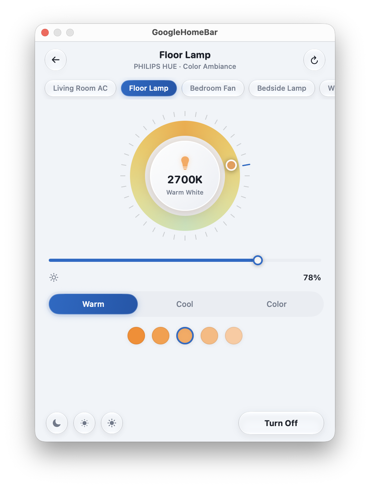
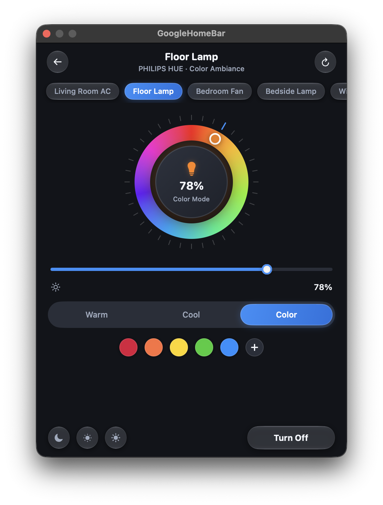
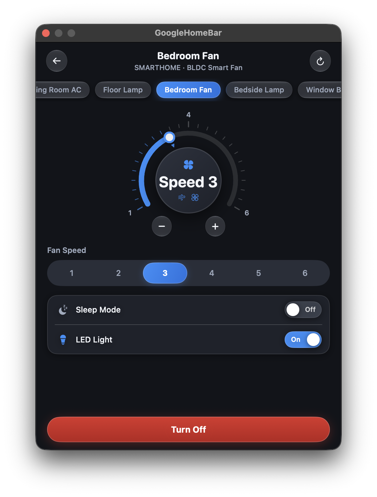
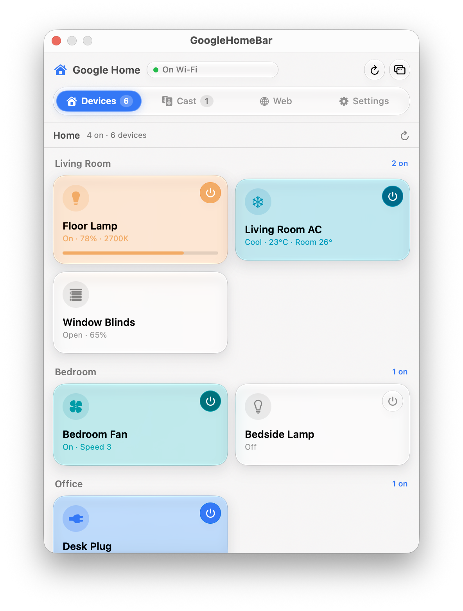
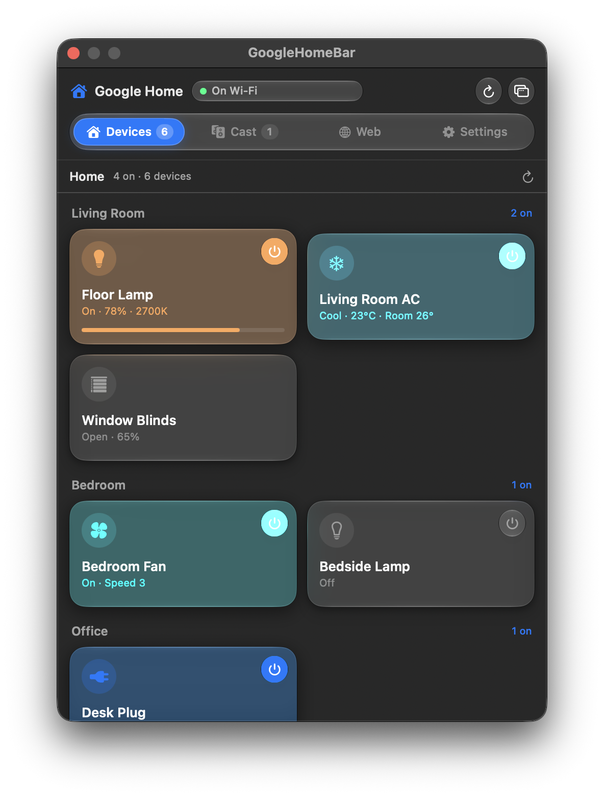
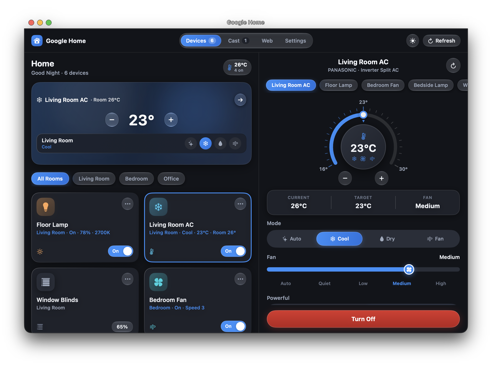

<div align="center">

# GoogleHomeBar

**A native macOS menu bar app to control all your Google Home & Cast devices — built with SwiftUI & macOS Liquid Glass.**

[](https://github.com/Tarachand-Gupta/GoogleHomeBar)
[](https://swift.org)
[](LICENSE)

Control lights, air conditioners, smart fans, blinds, plugs, thermostats, and local Cast speakers/TVs right from your macOS menu bar — over any internet connection, using your signed-in Google account with zero third-party cloud bridges or API keys.

</div>

---

## Screenshots

### Modern UX — Light & Dark Mode

Liquid Glass floating navigation dock, atmospheric climate hero card, room filters, tactile `On / Off` capsule switches, and smooth card expand/shrink transitions.

<table>
  <tr>
    <td align="center" width="50%">
      <br/>
      <sub><b>Modern Dashboard — Light Mode</b></sub>
    </td>
    <td align="center" width="50%">
      <br/>
      <sub><b>Modern Dashboard — Dark Mode</b></sub>
    </td>
  </tr>
</table>

### Expanded Device Controls

Controls are **100% trait-driven** — automatically composed from whatever Google Smart Home traits each device declares (`OnOff`, `Brightness`, `ColorSetting`, `TemperatureSetting`, `FanSpeed`, `HumiditySetting`, `OpenClose`, `Volume`, `LockUnlock`, `StartStop`, `Modes`, and `Toggles`). When a device is switched off, controls dim and lock automatically while highlighting only the **Turn On** action.

<table>
  <tr>
    <td align="center" width="50%">
      <br/>
      <sub><b>Air Conditioner — 240° Arc Dial & Live Metrics (Light)</b></sub>
    </td>
    <td align="center" width="50%">
      <br/>
      <sub><b>Off-State Dimming — Highlighted Turn On (Dark)</b></sub>
    </td>
  </tr>
  <tr>
    <td align="center" width="50%">
      <br/>
      <sub><b>Smart Lamp — 360° Warm/Cool Ring Dial (Light)</b></sub>
    </td>
    <td align="center" width="50%">
      <br/>
      <sub><b>Smart Lamp — 360° Full RGB Color Ring (Dark)</b></sub>
    </td>
  </tr>
  <tr>
    <td align="center" colspan="2">
      <br/>
      <sub><b>Smart Fan — Speed Dial (1–6), Full-Area Pills & Full-Row Toggles (Dark)</b></sub>
    </td>
  </tr>
</table>

### Classic Native macOS Liquid Glass UI

Prefer a compact, translucent macOS Control Center feel? Switch anytime between **Modern** and **Classic** UX (and **System / Light / Dark** appearance) in **Settings → Interface & Theme**. On macOS 26+, Classic mode uses native `.glassEffect(.regular.interactive())` translucent tinted tiles and capsule bars (with frosted `.ultraThinMaterial` fallback on macOS 14–15).

<table>
  <tr>
    <td align="center" width="50%">
      <br/>
      <sub><b>Classic Liquid Glass — Light Mode</b></sub>
    </td>
    <td align="center" width="50%">
      <br/>
      <sub><b>Classic Liquid Glass — Dark Mode</b></sub>
    </td>
  </tr>
</table>

### Resizable Detached Split-View Window

Pop out the menu bar popover into a full desktop window with your device grid on the left and live dial inspector side-by-side on the right.

<p align="center">
  
</p>

---

## Features

- **Native macOS 26+ Liquid Glass & Motion:** Uses SwiftUI's native `glassEffect` and `GlassEffectContainer` on macOS 26/27 (with frosted material fallback on macOS 14–15), tactile glass press animations with spring feedback, and smooth card expand/shrink transitions.
- **Two Switchable Experiences:** Toggle between **Modern** (floating glass pill dock, hero climate card, rotary & arc dials) and **Classic** (compact native macOS Liquid Glass tile grid) anytime in Settings.
- **First-Class Light & Dark Mode:** Supports **System**, **Light**, and **Dark** themes synced across both SwiftUI views and native macOS window chrome, plus a one-click header toggle.
- **Generic, Trait-Driven Controls for Any Home:** Works automatically across single-trait and combo devices from any manufacturer — lights (RGB, tunable white, or dimmer-only), ACs/thermostats, discrete & percentage smart fans, blinds/shades, humidifiers, plugs, switches, locks, speakers, TVs, and vacuums/appliances — plus instant search and batched refreshes for homes with 100+ devices.
- **Zero-Friction Interaction:** Click anywhere on a device card to expand its full controls; toggle power directly via the dedicated `On / Off` switch. When a device is off, controls dim and lock automatically until you turn it back on.
- **Local CastV2 Speakers & TVs:** Automatic Bonjour/mDNS (`_googlecast._tcp`) discovery on your Wi-Fi with direct TLS CastV2 volume sliders, mute, playback controls, album art, and master Mute All / Stop All actions.
- **Embedded Google Home Web Tab:** Persistent signed-in `home.google.com` view with Back/Forward, Zoom, Reload, and Open in Browser controls backed by a priority-arbitrated single `WKWebView` host.
- **Flexible Network Gating:** Use over **Any Internet** (default), **Any Wi-Fi**, or **Home Wi-Fi Only** (matching SSID, LAN subnet, or discovered home Cast devices) with a one-click session override.

---

## Quick Start

### Requirements

- macOS 14.0+ (macOS 26+ recommended for native Liquid Glass rendering)
- Xcode / Swift 6 toolchain

### Build & Install

```bash
git clone https://github.com/Tarachand-Gupta/GoogleHomeBar.git
cd GoogleHomeBar
chmod +x scripts/build-app.sh
./scripts/build-app.sh --install
open /Applications/GoogleHomeBar.app
```

To build without installing to `/Applications`:

```bash
./scripts/build-app.sh
open dist/GoogleHomeBar.app
```

### Try the UI Without Signing In (Demo Mode)

Preview the Modern & Classic Liquid Glass interfaces immediately with a built-in sample home:

```bash
/Applications/GoogleHomeBar.app/Contents/MacOS/GoogleHomeBar --open-popover --demo
```

Or open the detached split-view window in demo mode:

```bash
/Applications/GoogleHomeBar.app/Contents/MacOS/GoogleHomeBar --open-window --demo
```

---

## Testing

Run the Swift Testing unit test suite (JSPB Foyer codec, CastV2 framing/parsing, Wi-Fi gating, and `WKWebView` host ownership arbitration):

```bash
swift test
```

Run the automated live UI verification suite (uses the `agent-desktop` CLI with macOS Accessibility access):

```bash
./scripts/test-ui.sh --demo
```

---

## Architecture

```text
Sources/
├── GoogleHomeBarCore/               # Platform-independent testable core library
│   ├── GoogleHomeModels.swift       # Trait models + JSPB GetHomeGraph / GetTraits / UpdateTraits codec
│   ├── WebViewHostArbitrator.swift  # Deterministic priority ownership for the shared WKWebView
│   ├── CastMessageCodec.swift       # CastV2 protobuf wire codec & framing
│   ├── CastModels.swift             # Local Cast device & media state models
│   └── WiFiGating.swift             # Network / Home Wi-Fi access policy engine
└── GoogleHomeBar/                   # Native macOS SwiftUI + AppKit application
    ├── GoogleHomeBarApp.swift       # MenuBarExtra, Settings scene, --demo / --open-popover flags
    ├── Models/AppSettings.swift     # Persistent UX preset, Light/Dark mode, network & zoom settings
    ├── Services/                    # AppCoordinator, GoogleHomeManager, GoogleHomeWebController, WiFiMonitor
    ├── Cast/                        # Bonjour discovery & TLS CastV2 client
    └── Views/                       # ModernTheme (Liquid Glass), ModernDashboardView, ModernDeviceDetailView,
                                     # GoogleHomeDashboardView (Classic Glass), DetachedHomeWindowView, SettingsTabView
```

---

## Privacy & Security

- **Direct to Google Home:** Uses your own Google session inside `WKWebsiteDataStore.default()` on `home.google.com`. No third-party servers, proxies, or analytics.
- **No Credential Storage on Disk:** Session RPC headers stay strictly in memory inside the web context and are never written to disk or logged.
- **Local Cast Control:** Local speaker/TV discovery and playback run strictly over your LAN via mDNS + TLS CastV2.

---

## License

Released under the [MIT License](LICENSE).
